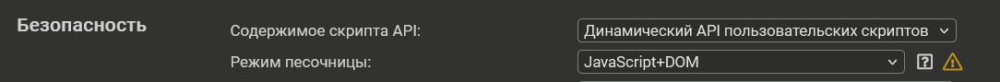

1. Ставите расширения TamperMonkey и SyncShare в браузер
2. Заходите в него, вставляете текст скрипта(TamperMonkeyScript.txt).
3. Заходите в настройки. Меняете режим конфигурации на "Опытный", в пункте "безопасность" выбираете следующие настройки:  
4. Запускаете все это дело и кайфуете

*Примечание*: SyncShare не все типы заданий может выполнять, проблемы не в скрипте.